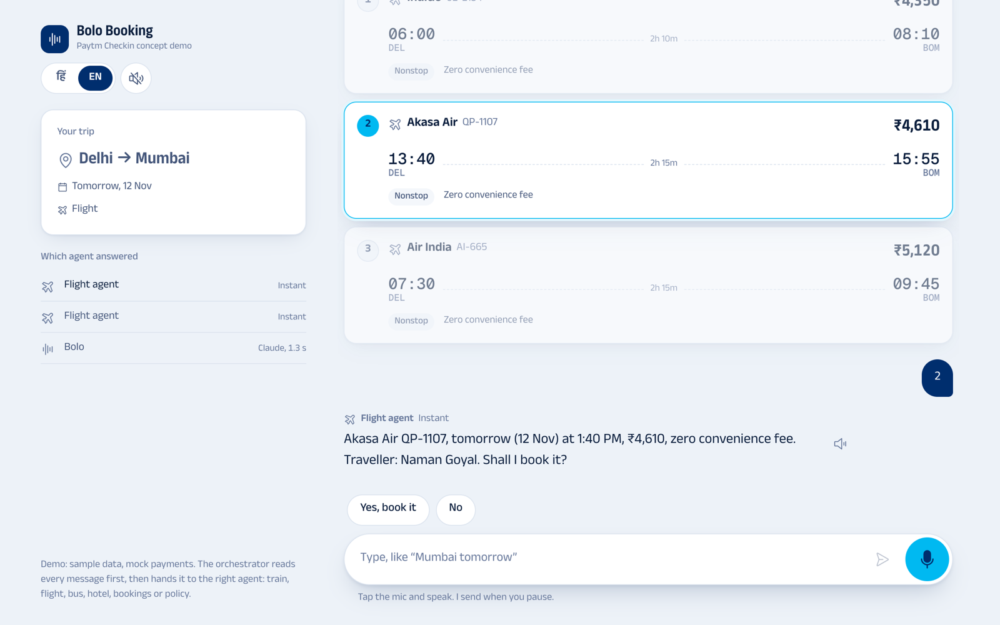
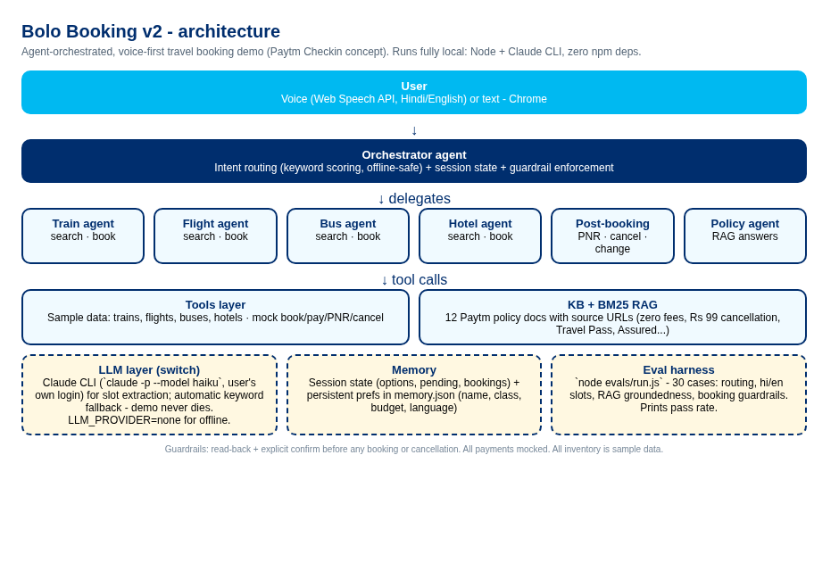
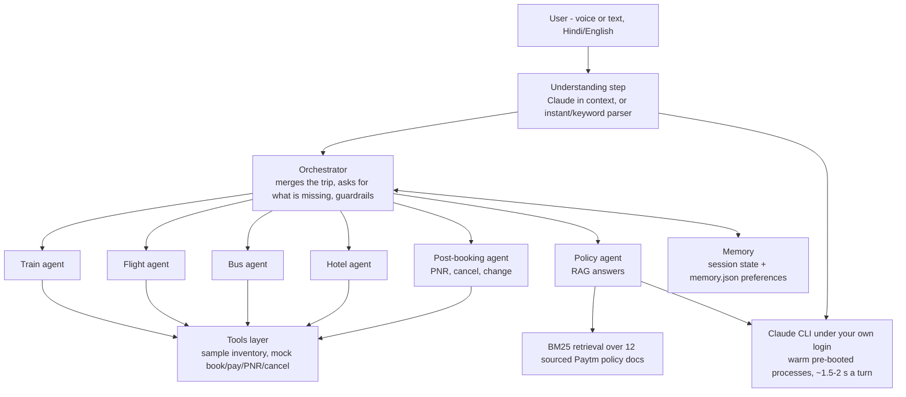
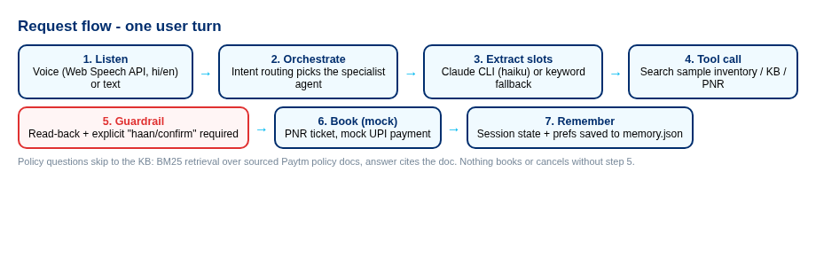

# Bolo Booking

**Voice-first, agent-orchestrated travel booking** - a concept demo for Paytm Checkin's travel vertical.

Speak Hindi or English ("कल मुंबई जाना है", "Delhi to Jaipur day after tomorrow"). The orchestrator understands each message in the context of the conversation and gives it to a specialist agent: **trains, flights, buses, hotels**, **post-booking** (PNR status, cancel, change) or **policy** (answers from a knowledge base). Every booking and cancellation needs a read-back and an explicit "yes". Payments are mocked. All inventory is sample data.



## Why

Paytm Checkin (launched Nov 2025) already has a conversational AI assistant for planning and booking. The missing layer is **voice-first, multilingual, agentic booking** for India's tier-2/3 users. This demo explores that layer: push-to-talk voice in, spoken replies out, and an agent-orchestrated backend behind it.

## How a conversation works

1. Tap the mic once and speak. The app shows the words live and sends them when you pause. Tap again to stop early.
2. The orchestrator reads the message with the trip so far, the options on screen and the last question it asked. Follow-ups work: "फ्लाइट दिखाओ", "parso ka", "sabse sasta", "wapsi".
3. If you name no travel mode, the app compares trains, flights and buses in one answer.
4. If you give only a destination, the origin is your home city. The reply names it, so you can correct it.
5. The reply comes in your language. Hindi replies use Devanagari, so the hi-IN voice reads them naturally.
6. The app reads the reply aloud. If the reply asks a question, the mic opens again by itself.
7. Chips under the conversation give the likely next answers. A tap answers instantly.

Short, clear replies ("haan", "दूसरा", "flight", "kal", a city name) skip the language model and answer in about 0 ms. Everything else goes to Claude.

## Architecture







## Run it

```bash
cd bolo-booking   # or the folder you extracted
node server.js
# open http://localhost:8787 in Chrome
```

Requires **Node 18+** and Chrome (for voice). Install the [Claude CLI](https://docs.claude.com/en/docs/claude-code) and log in. The app runs `claude -p --model haiku` under your own login, so it needs no API key. It keeps one pre-booted Claude process ready for each prompt, so a turn takes about 1.5 to 2 s instead of a cold start. Zero npm dependencies.

The UI loads the Anek Devanagari and Geist Mono fonts and the Phosphor icons from public CDNs. Without network access, the app uses system fonts and shows no icons.

| Mode | Command |
| --- | --- |
| Default (Claude CLI + auto-fallback) | `node server.js` |
| Fully offline (keyword parser) | `LLM_PROVIDER=none node server.js` |
| Evals | `node evals/run.js` |

## Evals

`node evals/run.js` runs 66 cases across seven suites and prints pass rates. It exits non-zero on a failure.

- **Intent routing**: each utterance goes to the right specialist.
- **Slot extraction**: Hindi and English, cities, dates ("kal" = tomorrow), budgets, classes.
- **Policy groundedness**: retrieval returns the right KB doc, and the answer carries its key fact.
- **Booking guardrails**: nothing books or cancels without an explicit confirmation.
- **Hindi**: Devanagari requests reach the right vertical (flights, buses, hotels, not only trains).
- **Conversation**: multi-turn flows. Follow-ups, mode and date changes, compare mode, return trips, budget carry-over.
- **Speech**: the text the voice reads has no codes, ISO dates or symbols, in Hindi and English.

Current score (offline mode, `LLM_PROVIDER=none node evals/run.js`): **66/66**.

## Knowledge base

`src/kb/policies.js` holds 12 Paytm travel policy/offer docs - zero convenience fees, Rs 99 flight cancellation cover, Rs 249 Travel Pass, Paytm Assured (buses), Ticket Assure (trains), instant train refunds, PNR confirmation prediction, 10+ languages, real-time flight tracking, hotels via Agoda - **each with its published source URL**. The policy agent answers only from retrieved docs.

## Honest limitations

- Understanding uses **Claude (haiku) when the CLI is logged in**. Otherwise a keyword parser does the work. The parser handles clear requests but misses free-form phrasing.
- Replies come from **bilingual templates**, not from the model. They are fast and exact, but less varied than free text.
- Voice uses the **browser's Web Speech API**. Recognition quality and the available voices depend on the browser. Chrome works best.
- Sessions live **in server memory**. A server restart forgets open conversations.
- RAG retrieval is **local BM25**, not embeddings/vector search.
- All inventory is **sample data**; booking, UPI payment, PNR and cancellation are **mocked**.
- Memory preferences are a simple JSON file, not a profile service.

## Stack

Plain Node.js (no dependencies), vanilla HTML/CSS/JS frontend (ES modules), browser Web Speech API for voice in and out, Claude CLI for understanding and policy answers.
