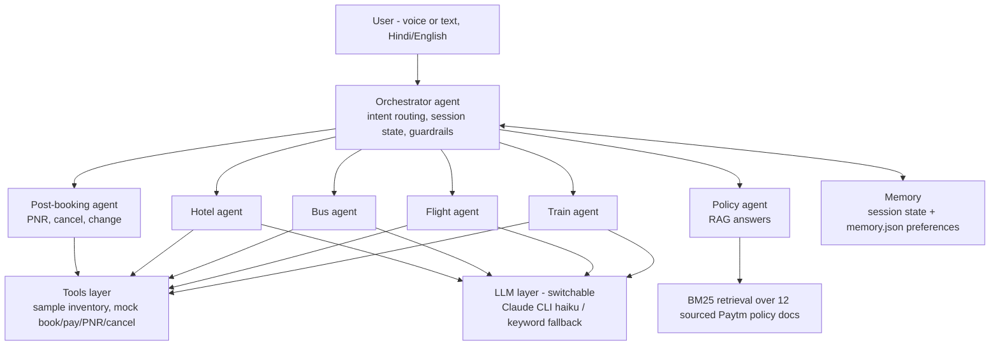

# Bolo Booking

**Voice-first, agent-orchestrated travel booking** - a concept demo for Paytm Checkin's travel vertical.

Speak Hindi or English ("Kal subah Delhi se Mumbai, 5000 ke andar") and an orchestrator agent delegates to tool-specialist agents across **trains, flights, buses and hotels**, with post-booking support (**PNR status, cancel, change**) and a **policy agent** that answers from a knowledge base over a local RAG pipeline. Read-back + explicit confirmation guard every booking and cancellation. Payments are mocked; all inventory is sample data.


## Why

Paytm Checkin (launched Nov 2025) already has a conversational AI assistant for planning and booking. The missing layer is **voice-first, multilingual, agentic booking** for India's tier-2/3 users. This demo explores that layer: push-to-talk voice in, spoken replies out, and an agent-orchestrated backend behind it.

## Architecture





## Run it

```bash
cd bolo-booking   # or the folder you extracted
node server.js
# open http://localhost:8787 in Chrome
```

Requires **Node 18+**. For the smart slot extractor, install the [Claude CLI](https://docs.claude.com/en/docs/claude-code) and log in - it runs `claude -p --model haiku` under your own login, no API key needed. Zero npm dependencies.

| Mode | Command |
| --- | --- |
| Default (Claude CLI + auto-fallback) | `node server.js` |
| Fully offline (keyword parser) | `LLM_PROVIDER=none node server.js` |
| Evals | `node evals/run.js` |

## Evals

`node evals/run.js` runs 30 cases across four suites and prints pass rates (exit non-zero on failure):

- **Intent routing** - utterances routed to the right specialist
- **Slot extraction** - Hindi/English, cities, dates ("kal" -> tomorrow), budgets, classes
- **Policy groundedness** - retrieval returns the right KB doc and the answer carries its key fact
- **Booking guardrails** - nothing books or cancels without an explicit confirmation

Current score (offline mode): **30/30**.

## Knowledge base

`src/kb/policies.js` holds 12 Paytm travel policy/offer docs - zero convenience fees, Rs 99 flight cancellation cover, Rs 249 Travel Pass, Paytm Assured (buses), Ticket Assure (trains), instant train refunds, PNR confirmation prediction, 10+ languages, real-time flight tracking, hotels via Agoda - **each with its published source URL**. The policy agent answers only from retrieved docs.

## Honest limitations

- Orchestrator **routing is keyword scoring**, not a learned classifier.
- Slot extraction is **Claude CLI when available**, a keyword parser otherwise (the demo never depends on the network).
- RAG retrieval is **local BM25**, not embeddings/vector search.
- All inventory is **sample data**; booking, UPI payment, PNR and cancellation are **mocked**.
- Memory preferences are a simple JSON file, not a profile service.

## Stack

Plain Node.js (no dependencies), vanilla HTML/JS frontend, browser Web Speech API for voice, Claude CLI for optional LLM slots.
